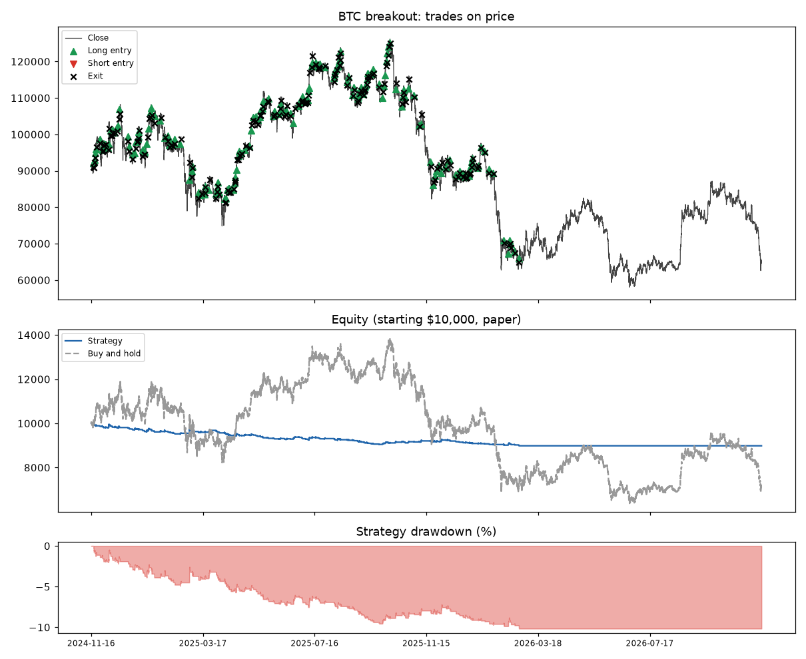
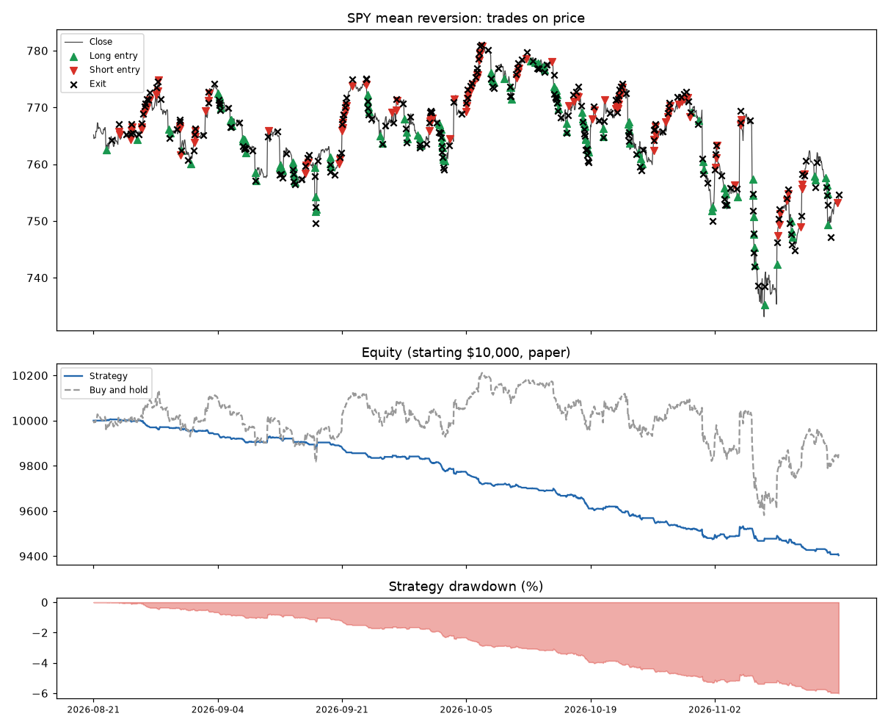
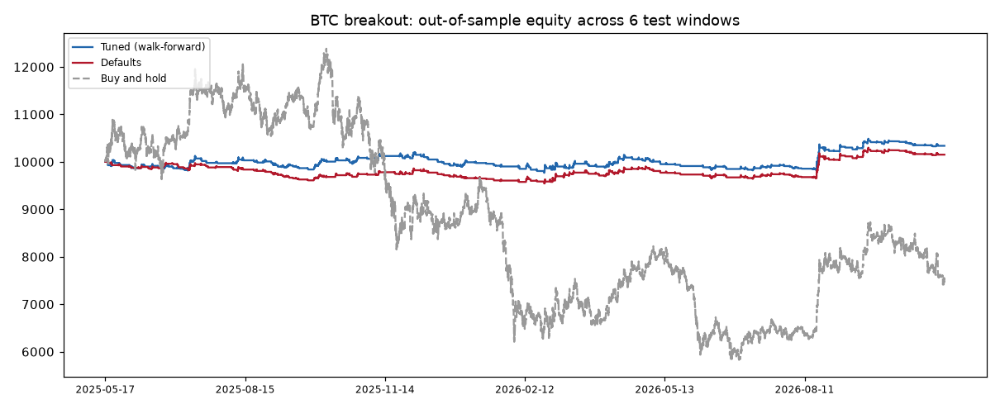
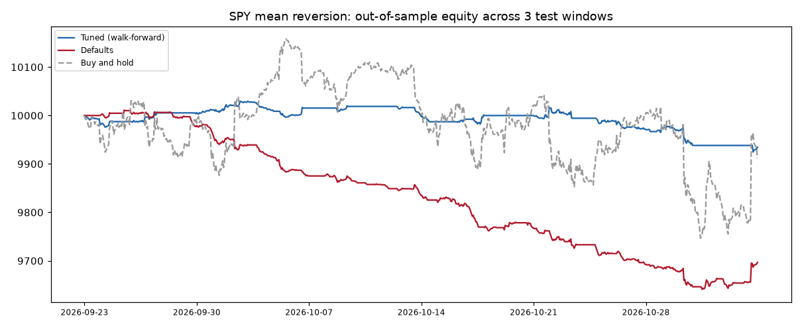

# Trading Bot (paper trading)

An automated trading bot that runs two rule-based strategies on **Alpaca paper trading** (simulated money, real market prices), with a public dashboard that shows every trade and the reason it fired.

> Paper trading only. This is an engineering project, not financial advice, and it makes no claims about profit.

## Strategies

| Market | Bars | Strategy | Entry | Exit |
|---|---|---|---|---|
| SPY | 15 min | Mean reversion | Close is 1.5+ std devs from the 20-bar mean (long below, short above) | Close returns to the mean, or the 1 ATR stop |
| BTC/USD | 1 hour | Momentum breakout (long only) | Close breaks the previous 20-bar high on 1.5x+ average volume | Close breaks the previous 20-bar low, or the 2 ATR trailing stop |

BTC is long only because Alpaca does not support short-selling crypto.

## Risk management

- **ATR position sizing:** the stop sits a fixed number of ATRs away, and the position is sized so that hitting it loses exactly 1% of equity. Volatile markets get smaller positions.
- **Position cap:** at most 25% of equity in one position.
- **Stops only tighten:** the trailing stop moves toward price and never away.
- **Circuit breaker:** if equity falls 10% from its peak, the bot stops trading until it is reset by hand.

All parameters live in `bot/config.py`.

## Backtest results (baseline parameters)

Real historical data from Yahoo Finance, $10,000 simulated starting equity, 0.05% slippage per fill, orders filled at the next bar's open.

| Run | Return | Max drawdown | Sharpe | Trades | Win rate | Profit factor |
|---|---|---|---|---|---|---|
| SPY mean reversion (2026-08-21 to 2026-11-13, 15-min) | -6.0% | 6.0% | -11.38 | 239 | 21% | 0.37 |
| Buy and hold SPY | -1.4% | 6.2% | -0.43 | | | |
| BTC breakout (2024-11-16 to 2026-11-15, 1-hour) | -10.2% | 10.2% | -1.51 | 181 | 27% | 0.61 |
| Buy and hold BTC | -28.5% | 54.0% | -0.16 | | | |

**What this shows:**
- **Neither baseline strategy is profitable on this data.** These are the textbook parameters, and the backtest is the tool for finding that out before risking anything.
- **SPY:** 183 of 239 trades hit the 1-ATR stop before price reverted. The stop sits closer than the 1.5-std-dev move the strategy waits for, so normal noise stops it out. Widening the stop, or requiring a bigger stretch, are the next experiments.
- **BTC:** the strategy lost 10% while buy and hold lost 28.5% with a 54% drawdown. The 10% circuit breaker tripped in early 2026, so the bot stopped trading and stayed flat through the rest of the decline (the flat equity line in the chart).
- **Position cap:** the 25% cap usually binds before the 1% risk rule, so typical SPY losses were about $5 (0.05% of equity) per trade.




Reproduce with `python -m bot.report` (add `--refresh` to download fresh data). Trade-by-trade logs, including the reason for every entry and exit, are in `docs/trades_*.csv`.

## Walk-forward tuning (out-of-sample)

Choosing the parameters that did best on all the data and then reporting that result is overfitting. Instead, `bot/tuning.py` slides a train window and a test window through the data:
- On each **train** window it tries every parameter combination (18 per strategy) and picks the best Sharpe ratio.
- It then runs only that choice on the following **test** window, which the tuning never saw.

The table below stitches the test windows together. Each window starts from fresh equity and a fresh circuit breaker, so these numbers differ from the full-period backtest above.

| Out-of-sample | Tuned (walk-forward) | Defaults | Buy and hold |
|---|---|---|---|
| **BTC** (6 test windows of ~3 months, May 2025 to Nov 2026) | **+3.4%**, max DD 4.3%, Sharpe 0.48 | +1.5%, max DD 4.8%, Sharpe 0.26 | -25.1%, max DD 53.1% |
| **SPY** (3 test windows of 10 trading days, Sep to Nov 2026) | -0.7%, max DD 1.0% | -3.0%, max DD 3.7% | -0.9%, max DD 4.0% |

**How to read this:**
- **BTC:** tuning beat the defaults out of sample and avoided buy and hold's 53% drawdown. But the edge is small, and much of it comes from a few trades in August 2026, so this is not evidence of a reliable profit.
- **SPY:** every fold chose the same settings (40-bar lookback, 2.0 std-dev entry, 2-ATR stop). That consistency is a good sign, and it cut losses from -3.0% to -0.7%. Still, only about 32 test trades over 60 days is far too small a sample to conclude anything.
- **Both:** low exposure keeps drawdowns small. The next step is more history from Alpaca, especially for SPY.




Full fold-by-fold tables, including the parameters each fold chose: `docs/walkforward_summary.md`. Reproduce with `python -m bot.tuning`.

## Paper trading on Alpaca

`python -m bot.live` checks both markets once and trades on **Alpaca's paper account**: simulated money, real prices. It's built to run every 15 minutes.

**Safety by design:** the broker wrapper always connects with `paper=True` and refuses to start if `ALPACA_PAPER` is anything but `true`. There is no live-money option in this codebase.

**Each run:**
1. Fetch recent bars and drop the one still forming. Act only on a new closed bar, never on the same bar twice.
2. Skip SPY while the market is closed.
3. Exit on a stop hit or a tripped circuit breaker. Trail the BTC stop.
4. Ask the strategy for a signal and place a market order if needed.
5. Append everything to `logs/signals.csv`, `logs/trades.csv` and `logs/equity.csv`. The dashboard reads these.

State that must survive between runs (last bar seen, stop prices, equity peak) lives in `state/bot_state.json`. Positions and equity always come from Alpaca.

**Live parameters** come from the most recent walk-forward fold. SPY uses a 40-bar lookback, a 2.0 std-dev entry and a 2-ATR stop, which every fold chose. BTC uses the defaults, which the latest fold chose.

**Setup:**
1. Create a free Alpaca account and generate **paper-trading** API keys.
2. Copy `.env.example` to `.env` and paste in the paper keys. `.env` is git-ignored.
3. Run `.venv\Scripts\python -m bot.live`.

**Known differences from the backtest:**
- **Fills:** orders fill near the next bar's open, but the stop is computed from the signal bar's close.
- **SPY data:** comes from Alpaca's free IEX feed, not the full consolidated feed.
- **BTC volume:** Alpaca only reports volume on its own venue, which is far lower than Yahoo's market-wide volume. The volume ratio still works but is noisier.

## Project layout

```
bot/
  config.py                 strategy and risk parameters
  indicators.py             SMA, std dev, z-score, EMA, ATR, prior-bar high/low/mean
  risk.py                   position sizing, stops, drawdown circuit breaker
  backtest.py               event-driven backtester (fills at the next bar's open)
  metrics.py                return, max drawdown, Sharpe, win rate, profit factor
  data.py                   historical bars from Yahoo Finance, cached in data/raw/
  report.py                 runs both backtests, saves charts and the summary table to docs/
  tuning.py                 walk-forward parameter tuning with out-of-sample results
  broker.py                 Alpaca paper-trading wrapper (paper only, by construction)
  live.py                   scheduled runner: signals, orders, stops, state and CSV logs
  strategies/
    base.py                 Signal / Action / Position types
    mean_reversion.py       SPY strategy
    momentum_breakout.py    BTC strategy
tests/                      unit tests (pytest)
```

Every strategy returns a `Signal` with an action, a plain-English reason and the numbers behind it, e.g.
`ENTER_LONG: Close 97.00 is 2.85 std devs below the 20-bar mean 100.33`. The dashboard will show these.

## Design choices

- **No lookahead:** signals use only closed bars, and breakout levels use the bars *before* the current one. A test checks that appending future bars never changes past indicator values.
- **Free to run:** Alpaca paper trading, GitHub Actions for scheduling, and GitHub Pages for the dashboard. No server costs.

## Run the tests

```bash
py -m venv .venv
.venv\Scripts\python -m pip install -r requirements.txt
.venv\Scripts\python -m pytest -q
```

## Roadmap

- [x] Indicators, both strategies, risk manager, unit tests
- [x] Backtester with equity curve and stats compared against buy-and-hold
- [x] Walk-forward parameter tuning (tune on older data, test on newer)
- [x] Alpaca paper-trading connection and trade log
- [ ] Scheduled runs on GitHub Actions
- [ ] React + TypeScript dashboard on GitHub Pages
